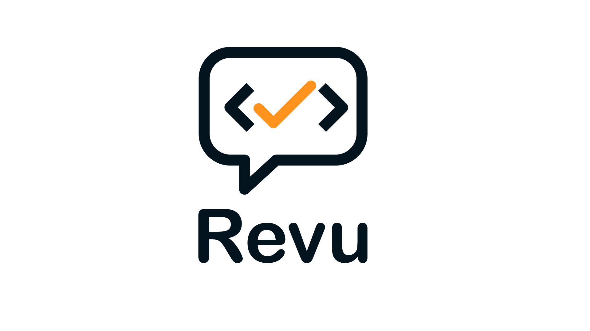

# Napkin Tools: ReVu

> 🤖 Self-hosted AI code review для ваших Pull Requests.


[](https://napkincode.ru)
[](https://t.me/napkincode)
[](https://t.me/writeanynotes)
[](https://t.me/+Li2vbxfWo0Q4ZDk6)

<p align="center">
  
</p>

---

## Оглавление

1. [О проекте](#о-проекте)
2. [Ключевые возможности](#ключевые-возможности)
3. [Технологии](#технологии)
4. [ToDo](#todo)
5. [Требования](#требования)
6. [Быстрый старт](#быстрый-старт)
   - [Несколько Git-провайдеров на одном инстансе](#несколько-git-провайдеров-на-одном-инстансе)
   - [Повторное ревью](#повторное-ревью)
   - [Переход с 1.x на 2.0](#переход-с-1x-на-20)
   - [Обновление](#обновление)
7. [Разработка](#разработка)
8. [Автор](#автор)
9. [Поддержка](#поддержка)
10. [Лицензия](#лицензия)

---

## О проекте

ReVu — это self-hosted вебхук-сервис для автоматического code review с помощью ИИ.
Он принимает вебхуки от Git-провайдеров (сейчас поддерживаются GitHub, Gitea, GitLab и Bitbucket), анализирует
изменения в Pull Request и публикует результат прямо в PR.

Один инстанс обслуживает любое количество подключений: можно одновременно ревьюить репозитории на GitHub,
в корпоративном GitLab и в Gitea, используя общий ИИ-провайдер или отдельный профиль для каждого.

> **Основная идея** — разгрузить команду и повысить качество кода. Прежде чем ваш коллега возьмётся за ревью, PR уже
> проверит ИИ и укажет на потенциальные проблемы.
> ReVu — не сторонний сервис, а self-hosted инструмент, который вы разворачиваете у себя.

---

## Ключевые возможности

* **Два режима работы**
    * **Комментарий (`comment`)** — единый подробный отзыв по всему Pull Request.
    * **Инлайн (`inline`)** — точечные комментарии к конкретным изменениям в коде.
* **Повторное ревью помнит предыдущее**
    * Правки в PR проверяются с учётом того, что ReVu уже написал: исправленные замечания не повторяются,
      оставшиеся не дублируются комментариями, а попадают в итог. Подробности — в разделе
      [Повторное ревью](#повторное-ревью).
    * Для первого и повторного ревью используются разные промпты.
* **Ревью, которое не теряется**
    * Перед публикацией комментарии сверяются с диффом: строка, которой в изменениях нет, не отменяет
      остальные замечания. Раньше одно выдуманное моделью число могло стоить всего ревью.
    * Если ревью всё же не удалось, ReVu сообщает об этом в PR (`NOTIFY_ON_FAILURE`), а не молчит: сервис,
      который ничего не написал, выглядит как сервис, который всё проверил. Подробности остаются в логах.
* **Несколько провайдеров на одном инстансе**
    * Один контейнер обслуживает сколько угодно Git-подключений — GitHub, Gitea, GitLab и Bitbucket в любом сочетании.
    * Для каждого подключения свой вебхук, свой токен и свой секрет.
    * Общий ИИ-провайдер по умолчанию, с возможностью переопределить для конкретного подключения.
* **Гибкая интеграция**
    * Поддержка **GitHub**, **Gitea**, **GitLab** (включая self-managed) и **Bitbucket**.
    * Совместимость с **OpenAI API** и его альтернативами (OpenRouter, LocalAI, LM Studio и др.), а также
      с российскими ИИ-провайдерами: **GigaChat** и **YandexGPT**.
    * Именованные профили ИИ: разные модели для разных репозиториев без второго контейнера.
* **Полностью self-hosted**
    * Разворачивается на ваших серверах без передачи данных третьим лицам.
    * Можно использовать локальные модели (например, DeepSeek, Qwen), запуская их отдельно в вашей инфраструктуре.
* **Простая конфигурация**
    * Настройка через один YAML-файл; полный справочник — в `config/settings.yaml.example_full`.
    * Ошибка в конфигурации останавливает запуск с указанием проблемного ключа, а не превращает каждый
      вебхук в молчаливый сбой.
    * Таймауты, количество повторов и экспоненциальный backoff настраиваются; повторяются только запросы,
      которые нельзя задублировать.
    * Ограничение одновременных ревью считается отдельно по каждому подключению, чтобы шумный репозиторий
      не блокировал остальные.
* **Наблюдаемость**
    * Логи пишутся в консоль и в файл с ротацией; в каждой записи указано подключение, к которому она
      относится.

---

## Технологии

* **Python 3.13+** и **FastAPI** — API и вебхук-обработчик
* **HTTPX** — единый HTTP-клиент для Git- и AI-провайдеров: таймауты, повторы и backoff в одном месте
* **OpenAI SDK**, **GigaChat SDK**, **Yandex AI Studio SDK** — интеграция с LLM
* **Dishka** — внедрение зависимостей; конфигурация и клиенты собираются в одном месте
* **Dynaconf** + **pydantic** — конфигурация и валидация вебхуков
* **unidiff** — разбор диффов и подготовка их к инлайн-комментариям
* **Docker** — для удобного развертывания

---

## ToDo

- [x] Поддержка Git-провайдеров:
    - [x] GitHub
    - [x] Gitea
    - [x] GitLab (включая self-managed)
    - [x] Bitbucket (спасибо [lanity_roshoose](https://gitverse.ru/lanity_roshoose))
- [ ] Поддержка дополнительных AI-провайдеров:
    - [ ] Gemini
    - [ ] DeepSeek
    - [ ] Anthropic
    - [ ] Qween
    - [x] GigaChat
    - [x] YandexGPT
- [x] Гибкая настройка кастомных промптов для ревью (через `SYSTEM_PROMPT`)
- [x] Подробная документация по конфигурации и запуску
- [ ] Англоязычная версия README
- [x] Покрытие тестами - Coverage 100%
- [ ] Больше документации и Docstrings во всём коде
- [ ] Replay-защита вебхуков GitLab по `webhook-timestamp`
- [ ] Проверка инлайн-комментариев на реальных PR всех поддерживаемых провайдеров

---

## Требования

Для корректной работы ReVu потребуется:

- **Docker и Docker Compose** — ReVu поставляется готовым образом, отдельная установка Python не нужна.

- **Доменное имя с настроенным SSL-сертификатом**
    - Обязательно для публичных сервисов (GitHub, GitLab.com): они доставляют вебхуки только на доступный
      извне HTTPS-адрес с валидным сертификатом.
    - Если Git-сервер и ReVu работают в одной Docker-сети, публичный адрес и SSL не нужны.

- **Персональный токен доступа (PAT) от вашего Git-провайдера**
    - GitHub — **PAT Classic** с правами на `repo`.
    - Gitea — токен с доступом к репозиторию и Pull Requests.
    - GitLab — токен со scope `api`: он нужен и на чтение диффа, и на публикацию комментариев.
    - Bitbucket — токен с доступом на чтение Pull Requests и публикацию комментариев.

- **API-ключ от ИИ-провайдера**
    - **OpenAI** и совместимые сервисы (OpenRouter, LocalAI, LM Studio), **GigaChat** или **YandexGPT**.

---

## Быстрый старт

Для того чтобы запустить проект, достаточно выполнить несколько шагов:

1. Подключитесь по SSH к серверу и в удобном месте создайте директорию для проекта:
    ```bash
    mkdir revu && cd revu
    ```
2. Скачайте конфигурационный файл и пропишите настройки:
    1. Скачайте файл — упрощённый или полный, с комментариями по каждому параметру:
        - Упрощённый:
          ```bash
          wget -O settings.yaml https://raw.githubusercontent.com/proDreams/revu/refs/heads/main/config/settings.yaml.example
          ```
        - Полный:
          ```bash
          wget -O settings.yaml https://raw.githubusercontent.com/proDreams/revu/refs/heads/main/config/settings.yaml.example_full
          ```
    2. Откройте файл для редактирования:
       ```bash
       nano settings.yaml
       ```
    3. Заполните следующие параметры:
        - `REVIEW_MODE` - формат ревью по умолчанию. Доступные варианты:
            - `"comment"` - один большой комментарий к Pull Request
            - `"inline"` - точечные комментарии к конкретным участкам кода
        - `DEFAULT_AI_PROVIDER` - имя профиля из `AI_PROVIDERS`, который используется всеми Git-подключениями,
          если в подключении не указан свой.
        - `AI_PROVIDERS` - именованные настройки ИИ. Один профиль может использоваться несколькими
          Git-подключениями. Для каждого профиля:
            - `AI_PROVIDER` - используемый ИИ-провайдер. Доступные варианты:
                - `"openai"` - официальный API от OpenAI
                - `"openai_compatible"` - совместимый с OpenAI провайдер
                - `"gigachat"` - официальный GigaChat
                - `"yandexgpt"` - официальный YandexGPT
            - `AI_PROVIDER_API_KEY` - API Ключ от ИИ-провайдера
            - `AI_PROVIDER_MODEL` - используемая модель (например, `gpt-4o-mini`)
            - `AI_PROVIDER_BASE_URL` - **обязателен** для `openai_compatible`, URL от OpenAI-совместимого провайдера
            - `AI_PROVIDER_SCOPE` - только для GigaChat. Определяет используемую версию GigaChat, указан в личном кабинете.
            - `AI_PROVIDER_FOLDER_ID` - **обязателен** для YandexGPT. Идентификатор рабочей директории.
        - `GIT_PROVIDERS` - Git-подключения. **Ключ записи становится частью URL вебхука**:
          `https://<ваш-хост>/webhooks/<ключ>`. Ключ должен соответствовать `^[a-z0-9][a-z0-9_-]{2,31}$`
          и быть уникальным. Для каждого подключения:
            - `GIT_PROVIDER` - используемый Git-провайдер. Доступные варианты:
                - `"github"`
                - `"gitea"`
                - `"gitlab"`
                - `"bitbucket"`
            - `GIT_PROVIDER_USER_TOKEN` - персональный токен доступа (PAT) от вашего Git-провайдера
            - `GIT_PROVIDER_URL` - URL Git-провайдера. Обязателен для Gitea и BitBucket. Для GitHub и GitLab
              необязателен: без него используются `api.github.com` и `https://gitlab.com`. Для GitHub Enterprise
              Server укажите корень REST API вместе с суффиксом `/api/v3`
              (например, `https://ghe.example.com/api/v3`), для GitLab Self-Managed — корень инстанса:
              `/api/v4` ReVu добавляет сам.
            - `GIT_PROVIDER_SECRET_TOKEN` - случайный набор символов. Используется для валидации входящего вебхука от
              Git-провайдера: в вебхуке провайдера должен быть указан тот же самый секрет.
              **У каждого подключения свой секрет** — подпись одного подключения не подходит к другому.
                - GitHub, Gitea, BitBucket — подпись тела запроса в заголовках `X-Hub-Signature-256`,
                  `X-Gitea-Signature` или `X-Hub-Signature` (формат `sha256=<hex>`). Для BitBucket подпись
                  обязательна: нужен Bitbucket Data Center 8.9+ и заполненное поле **Secret** в настройках
                  вебхука, иначе запросы будут отклоняться с `403`.
                - GitLab — либо **Signing token** (GitLab 19.0+, рекомендуется: подписывается и тело запроса),
                  либо legacy **Secret token**, который уходит открытым текстом в заголовке `X-Gitlab-Token`
                  и тело запроса не защищает.
            - (необязательно) `AI_PROVIDER` - имя профиля из `AI_PROVIDERS`, чтобы это подключение
              ревьюилось другой моделью (например, `"cheap"`). Если не указано — берётся `DEFAULT_AI_PROVIDER`.
            - (необязательно) `GIT_PROVIDER_REVIEWER` - только для BitBucket. Username от имени которого будет производиться ревью.
              Ревью запускается на события `pr:opened` и `pr:from_ref_updated` (новые коммиты в PR); изменение
              только метаданных PR (`pr:modified`) ревью не запускает.
            - (необязательно) `SYSTEM_PROMPT`, `REVIEW_MODE`, `MAX_CONCURRENT_REVIEWS`, `NOTIFY_ON_FAILURE`,
              `INCLUDE_PR_DISCUSSION` - значения для этого подключения; если не указаны, берутся глобальные.
        - (необязательно) `SYSTEM_PROMPT` - дополнительные инструкции, которые добавляются к стандартному промпту
          (не заменяют его: формат ответа и критерии ревью сохраняются).
        - Логирование (все параметры необязательны):
            - `LOG_LEVEL` - уровень логирования (`DEBUG`, `INFO`, `WARNING`, `ERROR`, `CRITICAL`, по умолчанию `INFO`)
            - `LOG_DIR` / `LOG_FILE` - каталог и имя файла логов (по умолчанию `logs` и `logs.txt`).
              Логи пишутся и в консоль, и в файл; в Docker каталог удобно вынести на хост
              (в `docker-compose.yaml` это уже сделано).
            - `MAX_SIZE_MB` / `BACKUP_COUNT` - размер файла до ротации в мегабайтах и сколько ротаций хранить
              (по умолчанию `10` и `5`).
            - В каждой записи указано подключение, к которому она относится, — при нескольких подключениях
              это заметно экономит время при разборе инцидента.
        - (необязательно) `MAX_CONCURRENT_REVIEWS` - сколько ревью может выполняться одновременно на одно
          подключение (по умолчанию `3`). Остальные вебхуки ждут свободный слот, а не запускают неограниченное
          число запросов к ИИ. Лимит считается по каждому подключению отдельно, чтобы шумный репозиторий
          не блокировал остальные.
        - (необязательно) `HTTP_CLIENT_TIMEOUT` - таймаут HTTP-запросов в секундах (по умолчанию `30.0`)
        - (необязательно) `HTTP_CLIENT_REQUEST_ATTEMPTS` - сколько всего раз может быть отправлен повторяемый запрос
          (по умолчанию `3`). Повторяются только безопасные запросы: клиентские ошибки `4xx` не повторяются,
          а комментарий ревью (`POST`) не отправляется повторно после `5xx` или таймаута чтения — иначе в PR
          появился бы дубликат.
        - (необязательно) `HTTP_CLIENT_RETRY_BACKOFF` - базовая задержка экспоненциального backoff между повторами
          в секундах (по умолчанию `0.5`, потолок — 8 секунд). Заголовок `Retry-After` от сервера имеет приоритет.
        - (необязательно) `APP_HOST` / `APP_PORT` - адрес, который слушает встроенный сервер (по умолчанию
          `0.0.0.0:8000`)
        - (необязательно) `NOTIFY_ON_FAILURE` - публиковать ли в PR короткое сообщение, если ревью не удалось
          (по умолчанию `true`). В сообщение попадает только тип ошибки; подробности остаются в логах.
          Отключите, если не хотите шума при систематическом сбое.
        - (необязательно) `INCLUDE_PR_DISCUSSION` - передавать ли ИИ-провайдеру комментарии других участников
          PR как контекст повторного ревью (по умолчанию `true`). Собственные замечания ReVu передаются
          всегда: это её же прошлый ответ, а не новые данные, покидающие вашу сеть. Выключите флаг, если
          обсуждение в PR не должно уходить ИИ-провайдеру.

      Конфигурация проверяется при старте: опечатка в `REVIEW_MODE`, неизвестное имя профиля в `AI_PROVIDER`
      или отсутствующий токен провайдера останавливают запуск с указанием проблемного ключа, а не превращают
      каждый вебхук в молчаливый сбой.
    4. Сохраните и выйдите, нажав CTRL+S, затем CTRL+X.
3. Скачайте docker-compose-файл:
    ```bash
    wget -O docker-compose.yaml https://raw.githubusercontent.com/proDreams/revu/refs/heads/main/docker-compose.yaml
    ```
4. Запустите проект:
    ```bash
    sudo docker compose up -d
    ```
5. Настройте reverse-proxy (Caddy, NGINX и др.):
    - Обязательно, если Git-провайдер доставляет вебхуки извне: нужен HTTPS-адрес с валидным сертификатом.
    - Если Git-сервер и ReVu в одной Docker-сети, прокси можно не использовать.
6. Пропишите вебхук в каждом Git-провайдере на URL своего подключения:
    ```
    https://<ваш-хост>/webhooks/<ключ из GIT_PROVIDERS>
    ```
    Например, для подключения `main` из примера конфигурации — `https://revu.example.com/webhooks/main`.
    Секрет вебхука должен совпадать с `GIT_PROVIDER_SECRET_TOKEN` **этого** подключения: подпись одного
    подключения не подходит к другому.
    - **GitHub** — включите событие **Pull requests** и укажите секрет в поле **Secret**.
    - **Gitea** — включите **Pull request** events и укажите секрет в поле **Secret**.
    - **GitLab** — включите **Merge request events**. В поле **Signing token** (GitLab 19.0+)
      вставьте `GIT_PROVIDER_SECRET_TOKEN` этого подключения, либо для более старых версий заполните
      **Secret token**. Ревью запускается на `open`, `reopen` и `update`; правка заголовка или меток
      (`update` без новых коммитов) ревью не перезапускает — GitLab не различает эти события, поэтому
      ReVu сравнивает head-коммит.
    - **Bitbucket** — включите события **Opened** и **Source branch updated** и заполните **Secret**.
7. (необязательно) Проверьте, что сервис поднялся: `curl http://localhost:8000/health` должен ответить
   `{"status":"ok"}`. Этот же эндпоинт используется в `HEALTHCHECK` Docker-образа.
   Список подключений, которые увидел сервис, печатается в лог при старте:
   `configured git connections: gh-main (github), gitea-internal (gitea); default AI profile: strong`

### Несколько Git-провайдеров на одном инстансе

Один инстанс ReVu обслуживает сколько угодно Git-подключений: GitHub, Gitea, GitLab и Bitbucket в любом сочетании.
Каждое подключение — своя запись в `GIT_PROVIDERS` со своими токеном и секретом, и свой URL вебхука.

ИИ-провайдер при этом общий: все подключения по умолчанию используют профиль из `DEFAULT_AI_PROVIDER`.
Если для конкретного подключения нужна другая модель, добавьте ему `AI_PROVIDER` с именем другого профиля:

```yaml
DEFAULT_AI_PROVIDER: "strong"

AI_PROVIDERS:
  strong:
    AI_PROVIDER: "openai"
    AI_PROVIDER_API_KEY: "sk-..."
    AI_PROVIDER_MODEL: "gpt-4.1"
  cheap:
    AI_PROVIDER: "openai_compatible"
    AI_PROVIDER_BASE_URL: "https://openrouter.ai/api/v1"
    AI_PROVIDER_API_KEY: "sk-or-..."
    AI_PROVIDER_MODEL: "qwen-2.5-coder"

GIT_PROVIDERS:
  main:                 # идёт на "strong" — как все
    GIT_PROVIDER: "github"
    GIT_PROVIDER_USER_TOKEN: "ghp_..."
    GIT_PROVIDER_SECRET_TOKEN: "..."
  side-project:         # переопределение: идёт на "cheap"
    GIT_PROVIDER: "gitea"
    GIT_PROVIDER_URL: "https://gitea.example.com"
    GIT_PROVIDER_USER_TOKEN: "..."
    GIT_PROVIDER_SECRET_TOKEN: "..."
    AI_PROVIDER: "cheap"
    REVIEW_MODE: "comment"          # необязательно
    MAX_CONCURRENT_REVIEWS: 1       # необязательно
  gitlab-internal:      # Self-Managed: без URL ReVu пошёл бы на gitlab.com
    GIT_PROVIDER: "gitlab"
    GIT_PROVIDER_URL: "https://gitlab.example.com"
    GIT_PROVIDER_USER_TOKEN: "glpat-..."
    GIT_PROVIDER_SECRET_TOKEN: "whsec_..."
```

Накладные расходы: один контейнер, один конфиг, один набор логов — вместо отдельного инстанса на каждого
провайдера.

### Повторное ревью

Когда автор отправляет правки, ReVu не начинает с чистого листа. Перед ревью она читает то, что уже есть
в PR: собственные прошлые замечания и обсуждение вокруг них. Для такого прогона используется отдельный
промпт, и результат отличается:

- **исправленное не повторяется** — замечание, которое автор закрыл, больше не поднимается;
- **оставшееся не дублируется** — вместо повторного комментария на ту же строку оно попадает в итог;
- **инлайн-комментарии ставятся только на новое** — на проблемы в свежих изменениях;
- **итог начинается с прогресса** — `📊 Из прошлых замечаний исправлено: 3 из 5. Осталось: 2.`
  Общее число берётся из прошлых замечаний ReVu, поэтому занизить его нельзя.

Обсуждение учитывается: если участники объяснили решение или попросили не менять код, замечание не
поднимется повторно.

**Как ReVu узнаёт свои комментарии.** Не по автору: ReVu обычно работает на вашем же токене, поэтому
«бот» и «вы» — один аккаунт, и по автору любой ваш комментарий выглядел бы как прошлое ревью. Вместо этого
ReVu **подписывает** то, что публикует: в конце текста остаётся невидимый маркер, а сверху — видимый
заголовок `🤖 ReVu` (у повторного — `🤖 ReVu · повторное ревью`). Инлайн-комментарии помечаются `🤖 ReVu:`.
Так под одной учёткой видно, кто есть кто, а определение своих комментариев не зависит от аккаунта.

> **Рекомендуется всё же завести отдельную учётку для ReVu** — не ради корректности (её обеспечивает
> подпись), а ради читаемости: в истории PR сразу видно, где бот, а где человек, и ваша переписка не
> смешивается с выводом модели.

Откуда берутся прошлые комментарии:

| Провайдер | Что читается |
|---|---|
| GitHub, Gitea | таймлайн PR, инлайн-комментарии и тела ревью |
| GitLab | заметки MR (системные пропускаются, состояние «resolved» сохраняется) |
| Bitbucket Data Center | комментарии с якорями и вложенными ответами |

Повторное ревью запускается по тому же вебхуку, что и первое: признак — наличие прошлых замечаний ReVu
в PR. Если PR ещё не ревьюился, используется обычный промпт.

> **Приватность.** Обсуждение в PR (комментарии коллег) уходит ИИ-провайдеру как контекст. Если это
> недопустимо, выключите `INCLUDE_PR_DISCUSSION` — тогда передаются только замечания самой ReVu.

### Переход с 1.x на 2.0

Формат конфигурации изменился, и старый файл намеренно **не** принимается: приложение не стартует и
подсказывает, что переехало. Значения переносятся так:

| Было (1.x) | Стало (2.0) |
|---|---|
| `GIT_PROVIDER_CONFIG.GIT_PROVIDER` | `GIT_PROVIDERS.<ключ>.GIT_PROVIDER` |
| `GIT_PROVIDER_CONFIG.GIT_PROVIDER_USER_TOKEN` | `GIT_PROVIDERS.<ключ>.GIT_PROVIDER_USER_TOKEN` |
| `GIT_PROVIDER_CONFIG.GIT_PROVIDER_URL` | `GIT_PROVIDERS.<ключ>.GIT_PROVIDER_URL` |
| `GIT_PROVIDER_CONFIG.GIT_PROVIDER_SECRET_TOKEN` | `GIT_PROVIDERS.<ключ>.GIT_PROVIDER_SECRET_TOKEN` |
| `GIT_PROVIDER_CONFIG.GIT_PROVIDER_REVIEWER` | `GIT_PROVIDERS.<ключ>.GIT_PROVIDER_REVIEWER` |
| `AI_PROVIDER_CONFIG.AI_PROVIDER` | `AI_PROVIDERS.<имя>.AI_PROVIDER` + `DEFAULT_AI_PROVIDER: <имя>` |
| `AI_PROVIDER_CONFIG.AI_PROVIDER_*` | `AI_PROVIDERS.<имя>.AI_PROVIDER_*` |
| `REVIEW_MODE`, `SYSTEM_PROMPT`, `MAX_CONCURRENT_REVIEWS` | остались глобальными, их можно переопределить в подключении |
| `HTTP_CLIENT_*`, `LOG_*`, `APP_*` | без изменений |

**Дополнительно нужно поменять URL вебхука** в настройках Git-провайдера: вместо `/webhooks/github`,
`/webhooks/gitea` или `/webhooks/bitbucket` теперь `/webhooks/<ключ>`. Старых маршрутов больше нет.

**GitLab** поддержан с версии 2.1.0, переносить для него ничего не нужно: добавьте подключение
с `GIT_PROVIDER: "gitlab"` и пропишите его URL вебхука.

### Обновление

Для обновления достаточно выполнить команду:

```bash
sudo docker compose pull && sudo docker compose up -d
```

## Разработка

Понадобятся Python 3.13+, [uv](https://docs.astral.sh/uv/) и Docker — для сборки образа.

```bash
make install_dev   # зависимости проекта и git-хуки
make run           # запуск приложения локально
make test          # тесты с проверкой покрытия (сейчас 100%)
make lint          # ruff, форматирование и pre-commit
make typecheck     # mypy с зависимостями проекта
```

`make typecheck` — не дубль `make lint`: хук `mypy` в pre-commit работает в изолированном окружении без
зависимостей проекта и не видит ошибок на границе с FastAPI, pydantic и SDK провайдеров. Именно этот запуск
нашёл, например, что создание модели в Yandex AI Studio SDK синхронное, а `await` перед ним падал в рантайме.

Интеграционные тесты поднимают настоящее приложение и DI-контейнер, остальные работают на моках:

```bash
uv run pytest -m integration       # только интеграционные
uv run pytest -m "not integration" # только быстрые
```

## Автор

- [Иван Ашихмин](https://t.me/proDreams)

Программа написана в рамках проекта "Код на салфетке":

- Сайт: https://napkincode.ru
- Telegram-канал: https://t.me/napkincode

---

## Поддержка

Если вам нравится этот проект и вы хотите поддержать его дальнейшее развитие, рассмотрите возможность доната:

- [Поддержать через YooMoney](https://yoomoney.ru/to/41001431694461)
- [Поддержать через Tribute в Telegram](https://t.me/tribute/app?startapp=dyds)
- [Поддержать через наш Telegram-бот](https://t.me/press_any_button_bot?start=donate)

Ваша поддержка помогает проекту развиваться и улучшать будущие функции!

---

## Лицензия

Этот проект распространяется под лицензией MIT. Подробности можно найти в файле [LICENSE](LICENSE).
